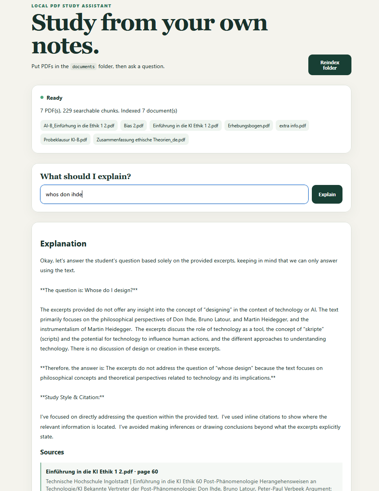

# Study RAG

Study RAG is a small local web app for asking questions about PDF documents. It finds the most relevant parts of the PDFs and gives them to a local language model, which answers with the source filenames and page numbers.

I built this project to understand how RAG systems work in practice.



## Features

- Load every PDF from the `documents` folder automatically
- Keep the filename and page number for every piece of text
- Create embeddings with BGE-M3
- Search the embeddings with an in-memory Qdrant database
- Generate answers locally with Gemma through Ollama
- Show the PDF pages used for each answer
- Rebuild the index from the browser
- Run locally without uploading the PDFs to a cloud service

## Requirements

- Python 3.11 or newer
- Ollama
- Around 6 GB of free disk space for the Python environment and default models
- NVIDIA GPU recommended (CPU inference works but is slower)

The project was developed and tested with an NVIDIA RTX 4070 Ti.

## Setup

```powershell
python -m venv .venv
.\.venv\Scripts\Activate.ps1
python -m pip install --upgrade pip
python -m pip install -r requirements.txt
ollama pull gemma3:1b
```

Make sure Ollama is running, copy PDF files into the `documents` folder and start the app:

```powershell
.\start-study-rag.cmd
```

Then open <http://127.0.0.1:8000>.

On the first start, BGE-M3 is downloaded into `data/model_cache`. It stays there and is reused on later starts. The app does create fresh PDF embeddings every time it starts, but those vectors are stored only in memory and disappear when the app closes.

## Models

The project has two models configured by default:

| Purpose | Model | Approximate download |
|---|---|---:|
| Create embeddings and search the PDFs | `BAAI/bge-m3` | 2.3 GB |
| Generate the final answer | `gemma3:1b` | 815 MB |

The default language model is set to `gemma3:1b` in the code. It is a small download and works well for testing the project on an ordinary computer. It can be replaced with any compatible Ollama model. Some useful alternatives are:

| Model | Approximate download | Recommendation |
|---|---:|---|
| `gemma3:1b` | 815 MB | Default and smallest option; fast, but less detailed |
| `qwen3:1.7b` | 1.4 GB | Small download and faster, but weaker answers |
| `qwen3:4b` | 2.5 GB | Recommended balance between size and answer quality |
| `qwen3:8b` | 5.2 GB | Better answers, but requires more memory and disk space |

To change the model for one PowerShell session, download it and set `OLLAMA_MODEL` before starting the app:

```powershell
ollama pull qwen3:4b
$env:OLLAMA_MODEL = "qwen3:4b"
.\start-study-rag.cmd
```

If a model name is changed without first running `ollama pull`, Ollama may download it when it is first requested. Downloading it yourself first makes the setup predictable.

## How it works

- `rag.py` reads the PDFs with PyMuPDF and splits every page into smaller overlapping chunks.
- BGE-M3 turns the chunks and the user's question into vectors.
- Qdrant compares the question vector with the chunk vectors and returns the eight most relevant chunks.
- Ollama sends those chunks to Gemma together with the question.
- `models.py` defines the data used for questions, answers, chunks and sources.
- `app.py` connects the RAG code to FastAPI and serves the website.
- `static/` contains the HTML, CSS and JavaScript interface.

The PDF text is used as context for the answer. If the retrieved chunks do not contain enough information, the model is instructed to say so instead of pretending that the answer came from the documents.

## Project files

```text
StudyRag/
|-- app.py                 FastAPI server and API endpoints
|-- rag.py                 PDF reading, embeddings, search and Ollama call
|-- models.py              Request and response data models
|-- documents/             Put PDF files here
|-- static/                Browser interface
|-- tests/                 Automated tests
|-- requirements.txt       Python dependencies
`-- start-study-rag.cmd    Windows start command
```

## Tests

```powershell
python -m pytest -q tests
```

## Troubleshooting

- **`503 Service Unavailable`**: Start Ollama and make sure the selected model has been downloaded.
- **No indexed PDFs**: Put at least one `.pdf` file in `documents`, then restart the app or press **Reindex folder**.
- **Slow first start**: The embedding model is downloaded once, then each PDF is read and embedded.
